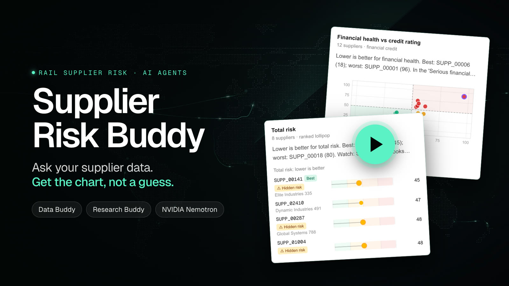
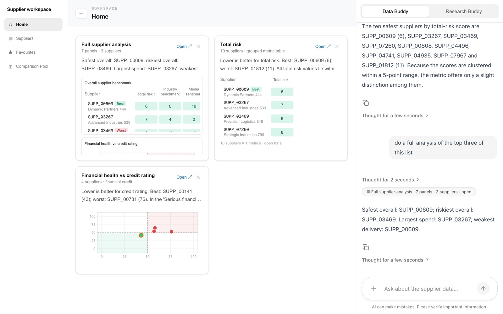
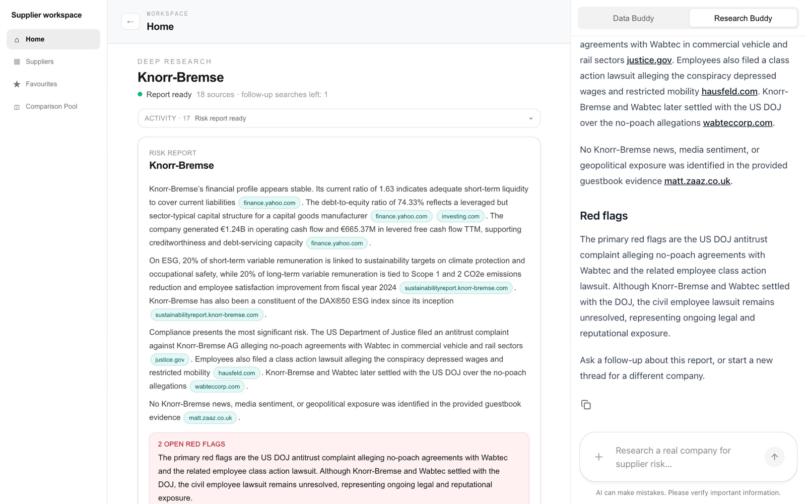
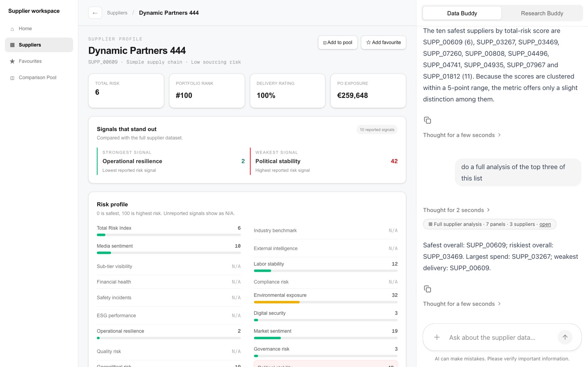
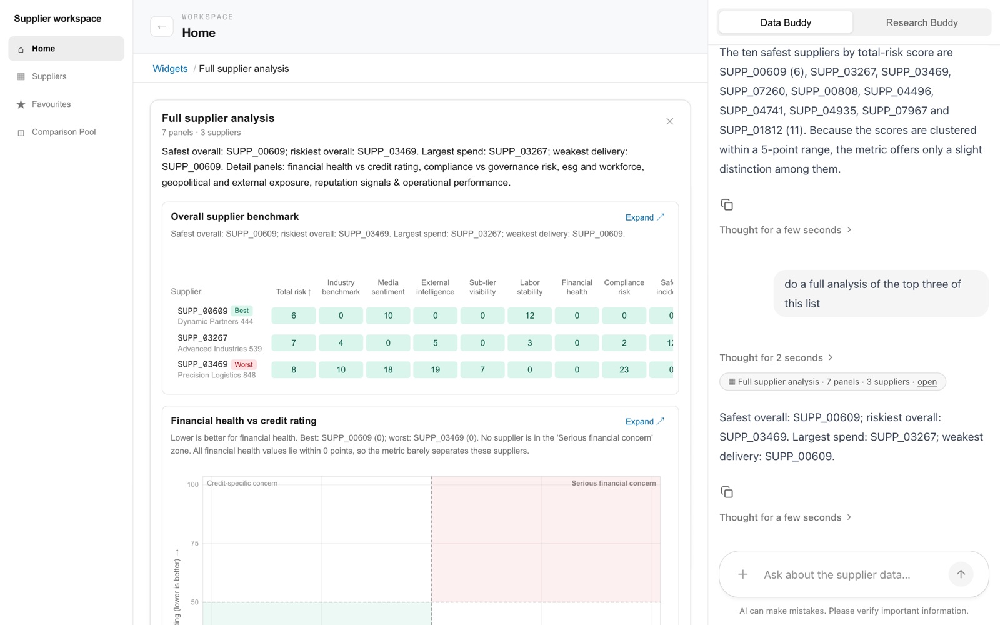
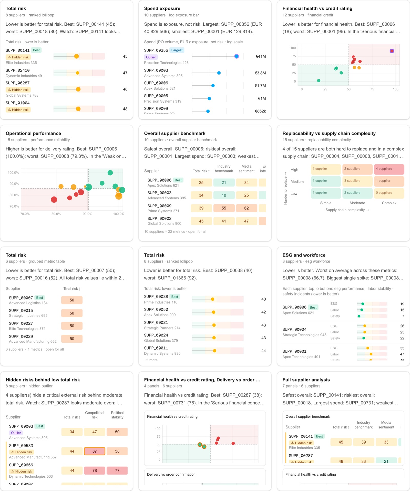
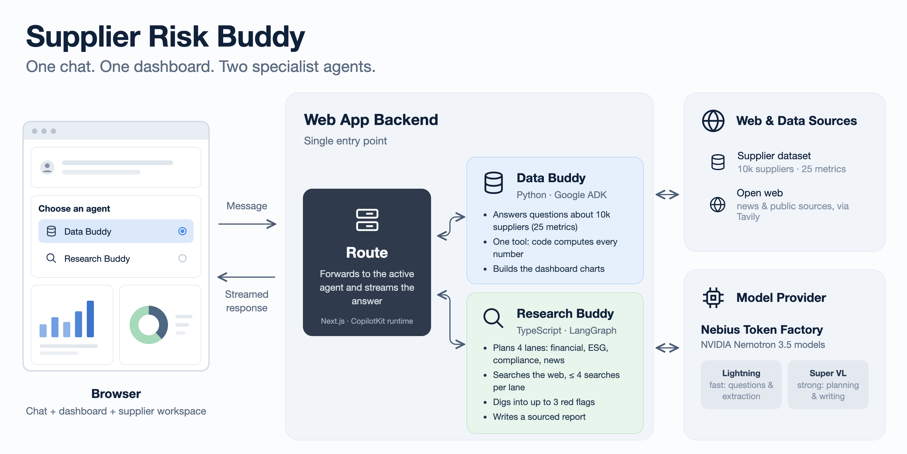
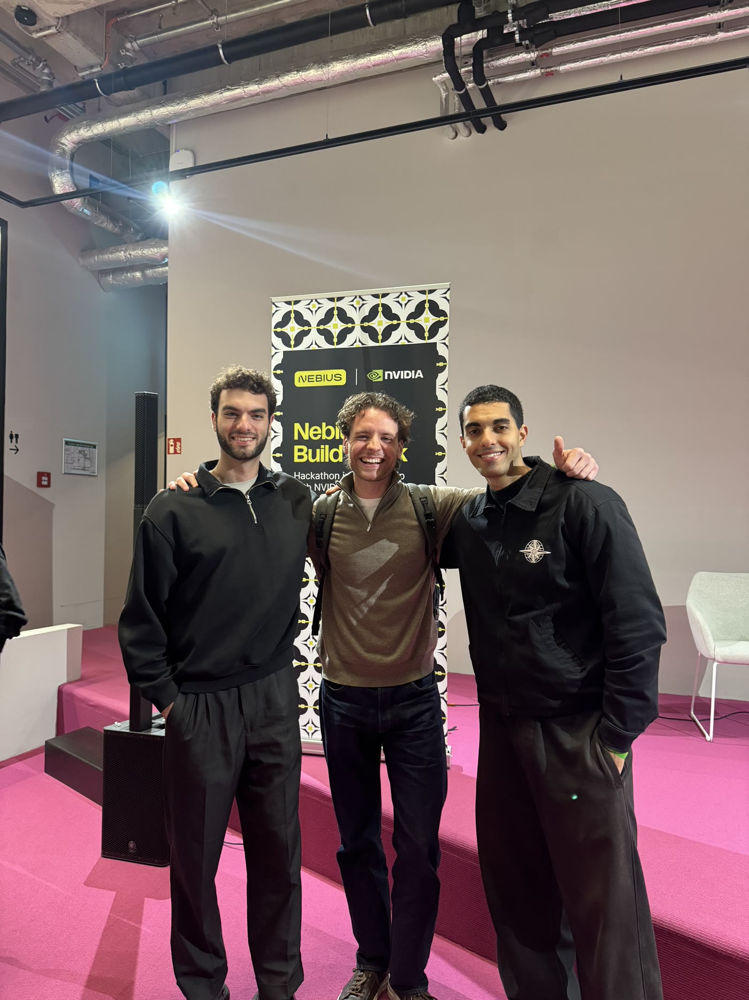

<div align="center">

# 🚆 Supplier Risk Buddy

**Ask your supplier data. Get the chart, not a guess.**

Two AI agents on NVIDIA Nemotron help rail buyers choose suppliers.<br>
One turns 10,000 supplier records into charts. The other researches real companies and writes a sourced risk report.

[](https://tokenfactory.nebius.com)
[](https://www.nvidia.com/en-us/ai-data-science/foundation-models/nemotron/)
[](https://google.github.io/adk-docs/)
[](https://langchain-ai.github.io/langgraph/)
[](https://copilotkit.ai)
[](https://nextjs.org)
[](agent/tests)
[](LICENSE)

[Try it](#quickstart) · [What it does](#what-it-does) · [How it works](#how-it-works) · [Proof](#proof) · [Limitations](#limitations) · [Team](#team)

<a href="https://cdn.jsdelivr.net/gh/lucazagaia/vibeLabs@a750022/docs/video/supplier-risk-buddy.mp4"></a>

<sub>▶ <a href="https://cdn.jsdelivr.net/gh/lucazagaia/vibeLabs@a750022/docs/video/supplier-risk-buddy.mp4">Watch the 25-second tour</a> (MP4, 8 MB)</sub>

</div>

<table>
<tr>
<td align="center" width="25%"><h3>10,000</h3>suppliers, 25 risk and performance metrics, up to 20 compared at once</td>
<td align="center" width="25%"><h3>0</h3>numbers written by the model: every value, ranking and summary is computed in code</td>
<td align="center" width="25%"><h3>12 / 12</h3>quick-eval questions: right metric, right "ask or not", no invented supplier IDs</td>
<td align="center" width="25%"><h3>16 / 16</h3>turns correct across two 8-turn chat threads</td>
</tr>
</table>

Built in a weekend by team **vibeLabs** for the Siemens challenge *"Smart Supplier Selection for Trains"* at the Nebius hackathon, Berlin, October 2026.

## Ask → answer

Real prompts, real replies. Each one also drops a card on the dashboard.

| You ask | What happens | You get |
|---|---|---|
| *"Which of SUPP_00012, SUPP_00450, SUPP_00731 and SUPP_00141 has the best credit rating?"* | Nemotron spots the metric; code ranks the four suppliers and picks the chart | A financial health vs credit rating scatter, plus: *"Lower is better for credit rating. Best: SUPP_00141 (43); worst: SUPP_00731 (76)."* |
| *"top 10 safest by total risk"* | Code ranks all 10,000 suppliers | A ranked card of the 10 safest |
| *"do a full analysis of the top three of this list"* | "This list" resolves to the card on screen, in its order | A 7-panel analysis: overview heatmap, financial, compliance, ESG, geopolitical, reputation, performance |
| *"Compare the financial risk of SUPP_00012 and SUPP_00450"* | "Financial risk" can mean two metrics, so it asks instead of guessing | *Financial health or Credit rating?* Answer either, or "all of them" |
| *"Research Knorr-Bremse for supplier risk"* (Research Buddy) | Plans, searches news and public sources, digs deeper on red flags | A risk report: 18 sources, 2 open red flags, every claim linked |

## Quickstart

Needs [uv](https://docs.astral.sh/uv/), Node.js 22+, a [Nebius Token Factory](https://tokenfactory.nebius.com) API key and a [Tavily](https://tavily.com) API key.

```bash
git clone https://github.com/lucazagaia/vibeLabs.git && cd vibeLabs
(cd agent && uv sync && npm ci && cp .env.example .env)   # then add NEBIUS_API_KEY and TAVILY_API_KEY to agent/.env
(cd web && npm ci && cp .env.local.example .env.local)
```

Run the three servers, each in its own terminal:

```bash
cd agent && uv run uvicorn main:app --port 8000   # Data Buddy (Google ADK)
```

```bash
cd agent && npm run dev                           # Research Buddy (LangGraph) on :8123
```

```bash
cd web && npm run dev                             # web app on :3000
```

Open http://localhost:3000 and click **Start now**. No API key handy? http://localhost:3000/cards shows every chart type from real data, no agent needed.

## What it does

| Part | What it does | Built with |
|---|---|---|
| **Data Buddy** | Plain-language questions become comparison cards: rankings, scatters with risk quadrants, heatmaps, and multi-panel analyses. 19 card types, picked by code from the question | Google ADK skill · Nemotron 3.5 Lightning |
| **Research Buddy** | Takes a real company name, plans its research, searches news and public sources, follows up on red flags, and writes a risk report with source links | LangGraph · Tavily · Nemotron 3.5 Super VL (planner) + Lightning (workers) |
| **Supplier workspace** | Filter and sort all 10,000 suppliers, open any supplier's risk profile, collect candidates in a comparison pool | Next.js, no LLM |
| **Widgets** | Every answer is a widget: a preview in the grid, then maximized with a path (*Widgets / Full supplier analysis / Financial health*) | CopilotKit `useRenderTool` |


<sub><b>The workspace:</b> comparison cards on the dashboard, Data Buddy chat on the right</sub>

### Research Buddy: a sourced risk report



### Supplier profile: every risk score at a glance



### A widget opened full-size



### The card types, from real data



<sub>All 12 example cards are at <code>/cards</code> when the app is running.</sub>

## How it works



<sub>The detailed version, with ports and protocols, is in <a href="docs/architecture.png"><code>docs/architecture.png</code></a>.</sub>

**The model understands; code decides.** Data Buddy uses Nemotron for exactly one step: reading the buyer's question. Everything after that is plain, tested Python.

```
"Which of these has the best credit rating?"
  ① Nemotron extracts   suppliers · topics ("credit rating") · intent          ← the only LLM step
  ② code checks          IDs must appear in the chat or on a card (never invented);
                         a vague phrase ("financial risk") → ask the buyer
  ③ code selects         named IDs · "this list" · "top 10 by total risk"
  ④ code routes          topic → one of 19 card templates (spec default per metric)
  ⑤ code checks the data skewed spend → log scale · near-identical values → a table, with a note
  ⑥ code computes        best, worst, quadrants, hidden risks → summary sentence
  ⑦ card → dashboard     the model only relays the summary
```

Want the details? The card contract is in [`docs/specs/card-contract.md`](docs/specs/card-contract.md), and the build log is in [`docs/plans/`](docs/plans/).

## Proof

| Check | Result |
|---|---|
| Unit tests: routing for all 25 metrics, ambiguity, follow-ups, facts vs the CSV | **60 / 60** pass, no API key needed (`cd agent && uv run pytest -q`) |
| Quick eval: 12 real questions through Nemotron | **12 / 12** right "ask or not", **12 / 12** exact metric, **0** invented IDs |
| Multi-turn chat: two 8-turn threads, as the browser sends them | **16 / 16** turns correct at reasoning `low` |

**Honest part:** these evals are small, one run each, and the model's wording varies between runs. With reasoning set to `none`, the same threads broke down from about the fourth turn: the model started *inventing* error messages like `[ERROR: Max turns (10) exceeded]`. That's why Data Buddy runs at `low`.

## Limitations

- **Data Buddy has one skill: comparison cards.** It compares and ranks 2–20 suppliers well, but single-supplier questions ("Why is SUPP_00018's risk so high?") and filtering by chat aren't supported; the workspace's profile page and filters cover those. In hindsight we'd give the agent one skill per buyer use case: explain, filter, compare, shortlist memo.
- **No persistence and no login.** Cards and chat threads live in the browser and reset on reload.
- **The supplier pages load all 10,000 rows at once** (`/api/suppliers`, ~16 MB): fine locally, slow over a slow connection.
- **Research Buddy** is only as good as the public sources it finds, and needs a Tavily key.

<details>
<summary><b>Configuration</b></summary>

- **`agent/.env`:**
  - `NEBIUS_API_KEY`, `TAVILY_API_KEY`
  - `NEBIUS_API_BASE`, default `https://api.tokenfactory.nebius.com/v1`
  - Data Buddy: `DATA_BUDDY_MODEL` (default `nebius/nvidia/Nemotron-3_5-Lightning`), `DATA_BUDDY_REASONING=low`
  - Research Buddy (LangGraph): `NEBIUS_ORCHESTRATOR_MODEL`, `NEBIUS_WORKER_MODEL`
- **`web/.env.local`:** `AGENT_BASE_URL` (server-only), `LANGGRAPH_DEPLOYMENT_URL`, `COPILOTKIT_TELEMETRY_DISABLED=true`
- **`deep_research/.env`:** see [`deep_research/.env.example`](deep_research/.env.example)

Restart the server after changing an env file.
</details>

<details>
<summary><b>Troubleshooting</b> (all things we actually ran into)</summary>

| Symptom | Cause | Fix |
|---|---|---|
| Research Buddy: `Unable to connect to LangGraph server` | The LangGraph server isn't running | `cd agent && npm ci && npm run dev` |
| `NEBIUS_API_KEY missing` | No `agent/.env` | `cp agent/.env.example agent/.env` and add your key |
| Every tool call fails with `No module named 'mcp'` | LiteLLM needs `mcp` for tool calls but doesn't declare it | It's already a dependency, so run `uv sync` |
| The model ignores browser tools like `show_notice` | The agent lacks `AGUIToolset()` | Every agent that should see frontend tools needs `AGUIToolset()` in its `tools` |
| The send button stays grey and the chat never connects | Next 16 *Cache Components*: CopilotKit generates IDs while rendering | Keep `<Providers>` wrapped in `<Suspense>` in `web/app/layout.tsx` |
| Calls go to `api.studio.nebius.ai` | LiteLLM's legacy default base URL for `nebius/` | `NEBIUS_API_BASE` is set explicitly in `buddy/models.py` |
| `address already in use` on :8000, :8123 or :3000 | An old server is still running | `lsof -ti tcp:8000 \| xargs kill` (same for the other ports) |
| `reasoning_effort` seems to do nothing | LiteLLM drops it for Nebius | It's sent through `extra_body` in `buddy/models.py` |
</details>

<details>
<summary><b>Repo layout</b></summary>

```
agent/                    Python ADK (port 8000) + TypeScript LangGraph (port 8123)
  main.py                 /data, /research, /health (ADK)
  buddy/cards/            the card engine: select · route · preflight · facts · summary · composite
  buddy/skills/           the supplier-comparison-cards ADK skill (SKILL.md)
  src/                    LangGraph deep research nodes
  tests/                  60 engine tests
deep_research/            Python one-shot CLI for the same research pipeline
web/                      Next.js 16 + CopilotKit v2
  app/dashboard/          the Buddies: workspace + chat
  components/cards/       rank · scatter · table · composite renderers
data/                     Siemens.csv (10,000 anonymized suppliers) + risk_criteria_description.md
docs/                     architecture, plans, specs, screenshots
```
</details>

<details>
<summary><b>Deep research as a Python CLI</b></summary>

The same research pipeline, one-shot, in [`deep_research/`](deep_research/):

```bash
cd deep_research
python -m venv .venv && source .venv/bin/activate
pip install -r requirements.txt
cp .env.example .env   # NEBIUS_API_KEY + TAVILY_API_KEY
python app.py "Research Siemens Mobility for ESG and compliance risk"
```
</details>

## Team

**vibeLabs**, Nebius hackathon Berlin 2026:



- **Alex**: Research Buddy (the LangGraph and Tavily pipeline, its live progress and report UI) and the landing page
- **Adham**: the supplier workspace (table, filters, profiles, comparison pool) and the architecture diagram
- **Luca**: Data Buddy (Google ADK and Nemotron), the card engine, and dashboard widgets

Thanks to Siemens for the challenge and dataset, and to Nebius and NVIDIA for Token Factory and Nemotron.

## License

[MIT](LICENSE). The supplier dataset in [`data/`](data/) is anonymized challenge data provided by Siemens for the hackathon and is not covered by this licence.
